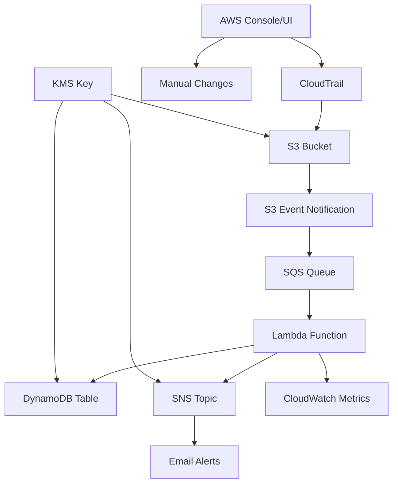

# IAC Drift Detection System

This Terraform project implements an automated Infrastructure as Code (IaC) drift detection system for AWS. It monitors AWS API calls via CloudTrail and alerts on manual/console changes that bypass IaC tools.

## Architecture Overview



## Components

### 1. AWS CloudTrail
- **Purpose**: Captures all AWS API calls across the account
- **Configuration**: Multi-region trail with log file validation enabled
- **Integration**: Delivers logs to S3 bucket every 5 minutes

### 2. S3 Bucket (CloudTrail Logs)
- **Purpose**: Secure storage for CloudTrail log files
- **Features**:
  - Server-side encryption with KMS
  - Versioning enabled
  - Public access blocked
  - Lifecycle policy (90-day retention)
- **Notifications**: Triggers SQS messages on new log file creation

### 3. SQS Queue (Processing)
- **Purpose**: Decouples S3 notifications from Lambda processing
- **Configuration**:
  - Visibility timeout: 15 minutes
  - Message retention: 24 hours
  - Dead letter queue for failed messages
- **Security**: Encrypted with KMS

### 4. AWS Lambda Function
- **Purpose**: Core processing engine that analyzes CloudTrail logs
- **Runtime**: Python 3.12
- **Timeout**: 150 seconds
- **Memory**: 256 MB
- **Triggers**: SQS event source mapping (batch size: 5)
- **Functions**:
  - Reads CloudTrail logs from S3
  - Identifies non-IaC changes using configurable rules
  - Stores findings in DynamoDB
  - Sends alerts via SNS
  - Publishes metrics to CloudWatch

### 5. DynamoDB Table (Findings)
- **Purpose**: Persistent storage for detected drift events
- **Schema**:
  - Primary key: `finding_id` (string)
  - Sort key: `event_time` (string)
  - GSI: `severity-index` on `severity` + `event_time`
- **Features**:
  - Pay-per-request billing
  - TTL enabled (90 days)
  - Encrypted with KMS

### 6. Amazon SNS (Alerts)
- **Purpose**: Notification service for alert delivery
- **Configuration**: Email subscription for alerts
- **Encryption**: Messages encrypted with KMS
- **Topics**: Separate topic for security alerts

### 7. AWS KMS (Encryption)
- **Purpose**: Manages encryption keys for all components
- **Features**:
  - Automatic key rotation
  - Key policies for cross-service access
  - 7-day deletion window

### 8. CloudWatch Metrics
- **Purpose**: Monitoring and alerting on system performance
- **Metrics**:
  - Total non-IaC changes detected
  - Changes by severity level
  - Lambda execution metrics

## Detection Logic

### IaC Identification Rules
The system identifies Infrastructure as Code changes using:

1. **User Agent Matching**: Requests from IaC tools (Terraform, CloudFormation, etc.)
2. **IAM Role Patterns**: Assumed roles with IaC-related names
3. **Source IP Whitelisting**: Known CI/CD runner IPs

### Severity Classification
- **CRITICAL**: High-risk events (security group changes, user creation)
- **HIGH**: Important resource changes (EC2 instances, databases)
- **MEDIUM**: Moderate changes (deletions, modifications)
- **LOW**: Minor changes

### Alert Triggers
- CRITICAL severity: Immediate alerts
- HIGH severity: Immediate alerts
- MEDIUM/LOW: Logged but no alerts

## Deployment

### Prerequisites
- AWS CLI configured with appropriate permissions
- Terraform >= 1.6.0
- Python 3.12 runtime access

### Quick Start
```bash
# Configure AWS credentials
aws configure

# Initialize Terraform
terraform init

# Review deployment plan
terraform plan

# Deploy infrastructure
terraform apply
```

### Configuration
Update `terraform.tfvars`:
- `alert_email`: Email address for alerts
- `iac_role_patterns`: IAM role patterns to whitelist
- `iac_user_agents`: User agents from IaC tools
- `iac_source_ips`: CI/CD runner IP addresses

## Security Considerations

### Encryption
- All data encrypted at rest using KMS
- S3 bucket with public access blocked
- IAM least-privilege access

### Monitoring
- CloudTrail logs all system activity
- CloudWatch metrics for operational visibility
- Dead letter queue for failed message handling

### Compliance
- SOC 2 compliant logging
- GDPR considerations for data retention
- Configurable data retention (TTL: 90 days)

## Troubleshooting

### No Alerts Received
1. Verify SNS email subscription confirmed
2. Check CloudTrail is logging events
3. Review Lambda CloudWatch logs
4. Confirm S3 notifications configured

### High Latency
- CloudTrail delivery: 5-15 minutes
- SQS processing: < 1 minute
- Lambda execution: < 30 seconds

### False Positives
- Add IaC patterns to `iac_role_patterns`
- Whitelist CI/CD IPs in `iac_source_ips`
- Update user agent patterns

## Cost Optimization

### AWS Service Costs
- CloudTrail: ~$2.50/month per region
- S3: ~$0.50/month for logs
- Lambda: ~$0.20/month for executions
- DynamoDB: Pay-per-request (~$1/month)
- SNS: ~$0.50/month for emails

### Retention Policies
- CloudTrail logs: 90 days
- Findings: 90 days TTL
- SQS messages: 24 hours

## Contributing

1. Fork the repository
2. Create feature branch
3. Test changes thoroughly
4. Submit pull request

## License

This project is licensed under the MIT License.</content>
<parameter name="filePath">/home/mahesh/Desktop/iac-drift-detection-terraform/README.md